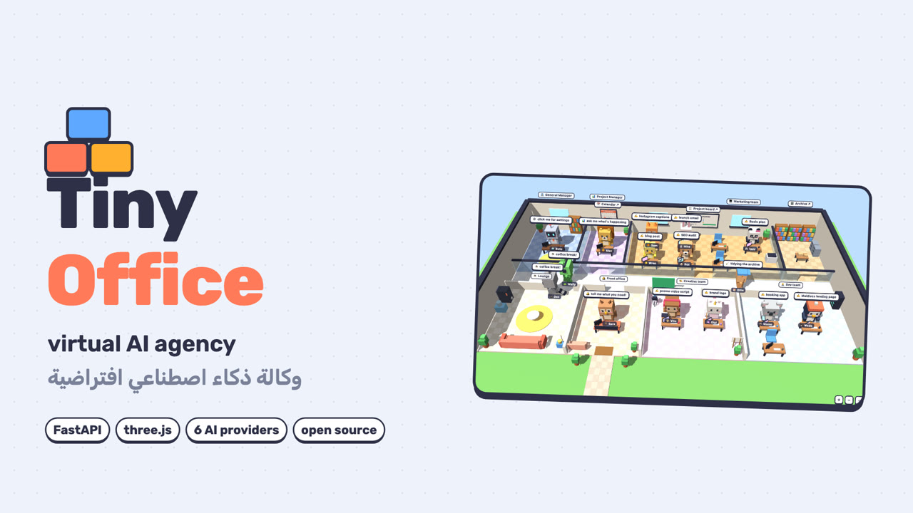
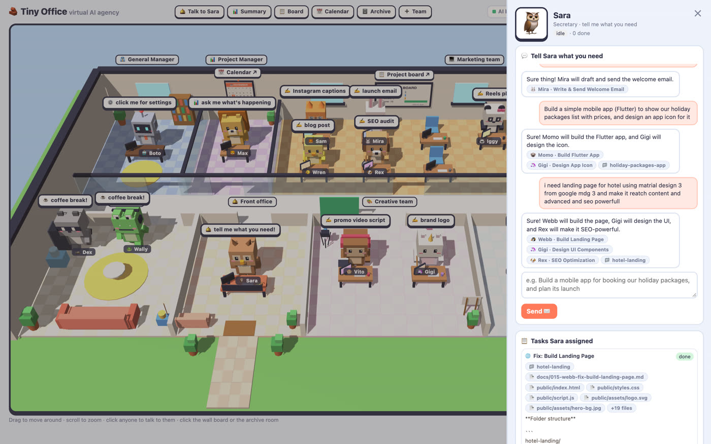
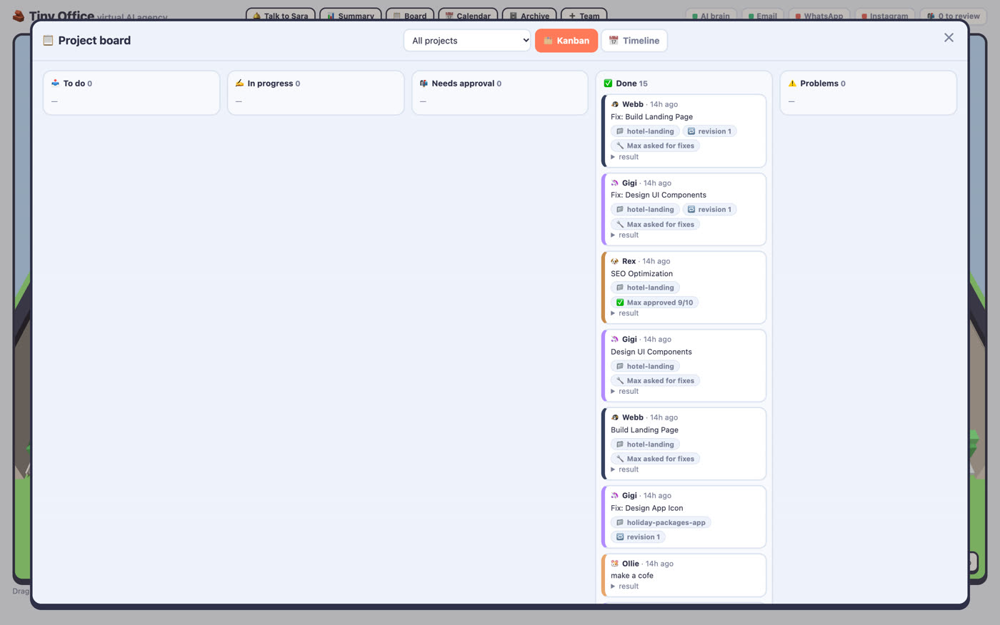
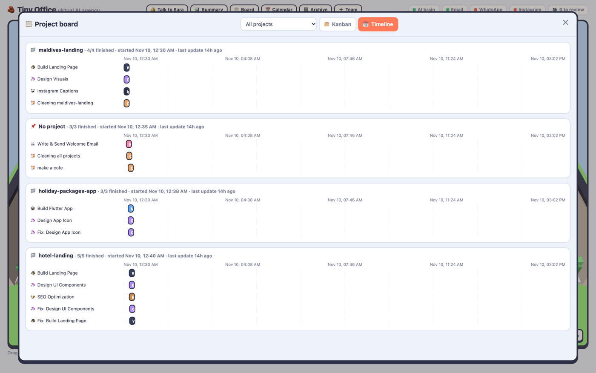
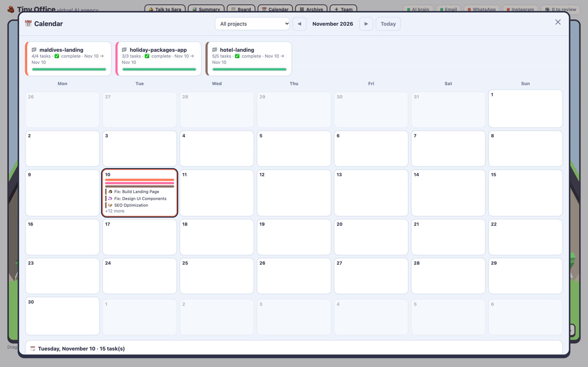
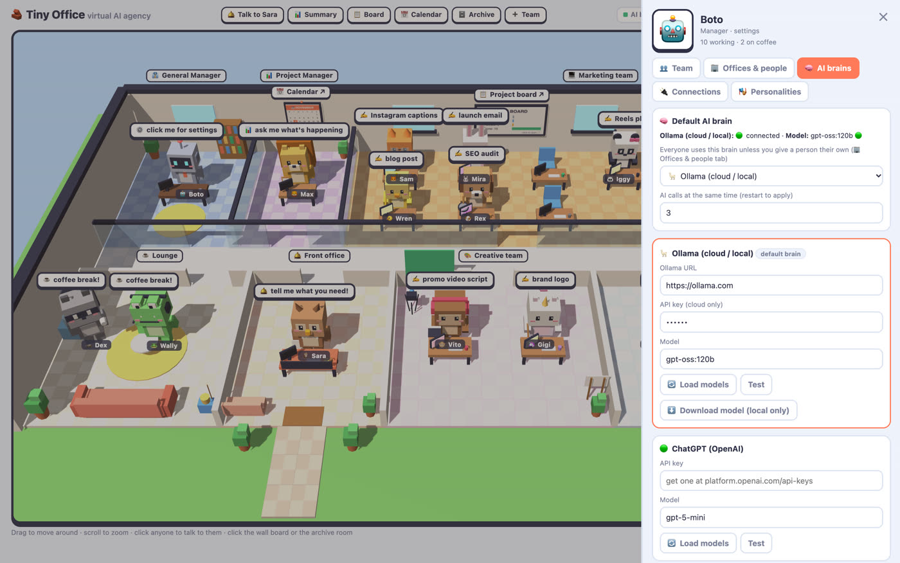
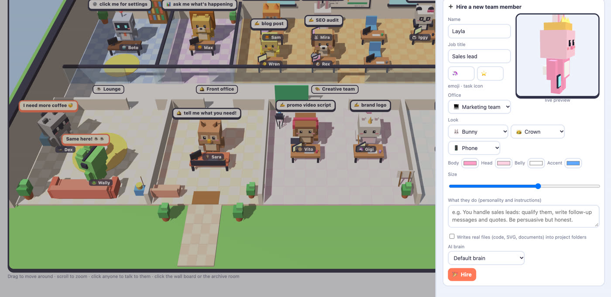
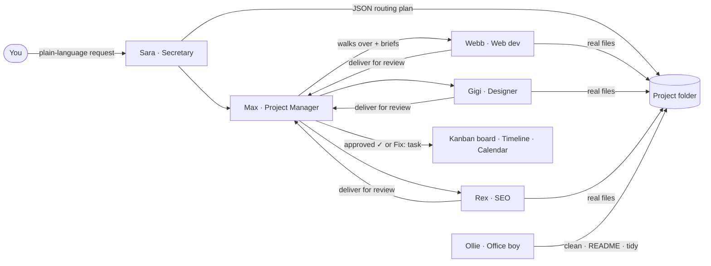

<div align="center">

# 🧱 Tiny Office: Open-Source Virtual AI Agency in 3D

**A multi-agent AI office you can watch work.** A secretary routes your request, a project manager assigns and reviews it, and a team of AI agents (developers, designers, writers, SEO and ads specialists) builds it, walking desk to desk in a cute 3D office.

[](#quick-start)
[](https://fastapi.tiangolo.com/)
[](https://threejs.org/)
[](#which-ai-models-does-tiny-office-support)
[](#quick-start)

**[🌐 Website](https://inats.github.io/tiny-office/) · [🚀 Quick start](#quick-start) · [❓ FAQ](#faq) · [⭐ Star this repo](https://github.com/iNATS/tiny-office/stargazers)**



https://github.com/user-attachments/assets/REPLACE-WITH-UPLOADED-VIDEO-ID

<sub>45-second tour · file: <a href="docs/media/tiny-office-demo.mp4">docs/media/tiny-office-demo.mp4</a></sub>

</div>

---

## What is Tiny Office?

**Tiny Office is a self-hosted, open-source multi-agent AI system that runs a whole digital agency as a 3D virtual office.** You describe a job in plain language. **Sara**, the AI secretary, decides which AI agent should do it. **Max**, the AI project manager, walks over to brief them, reviews the finished work and asks for fixes. The agents write **real files** (websites, mobile app code, SVG graphics, articles, video scripts) into a project folder on your disk.

It is built with **Python (FastAPI)** and **three.js**, needs no database, and works with **Ollama (local or cloud), OpenAI ChatGPT, Anthropic Claude, Google Gemini, DeepSeek and Alibaba Qwen**. You can give every agent a different AI model.

### Key facts

| | |
|---|---|
| **What it is** | A multi-agent AI orchestration app with a 3D office user interface |
| **Who it's for** | Freelancers, marketing agencies, small businesses, indie developers, AI hobbyists |
| **What it produces** | Landing pages, web apps, Flutter/mobile code, SVG logos and icons, blog posts, SEO audits, ad plans, email and social replies |
| **AI models** | Ollama (local + cloud), ChatGPT, Claude, Gemini, DeepSeek, Qwen, chosen per agent |
| **Stack** | Python 3.9+, FastAPI, httpx, three.js (no build step), JSON files for storage |
| **Channels** | Web dashboard, Email (IMAP/SMTP), WhatsApp Cloud API, Instagram Graph API |
| **Runs on** | Any machine that runs Python: macOS, Linux, Windows. A local model works on CPU via Ollama |

---

## Table of contents

- [Features](#features)
- [How it works](#how-it-works)
- [Meet the team](#meet-the-team)
- [Quick start](#quick-start)
- [Which AI models does Tiny Office support?](#which-ai-models-does-tiny-office-support)
- [Configuration](#configuration)
- [Connect email, WhatsApp and Instagram](#connect-email-whatsapp-and-instagram)
- [Project folders and output files](#project-folders-and-output-files)
- [REST API](#rest-api)
- [Project structure](#project-structure)
- [Use cases](#use-cases)
- [FAQ](#faq)
- [Security and privacy](#security-and-privacy)
- [Contributing](#contributing)
- [نبذة بالعربية](#نبذة-بالعربية)

---

## Features

### 🛎️ AI secretary that routes every task
Talk to **Sara** in plain language ("build a landing page for our Maldives hotel and make it SEO-friendly"). She replies, creates or picks the project, and splits the job across the right specialists automatically, for example *Webb builds the page, Gigi designs the UI, Rex does SEO*.



### 📊 AI project manager with review loop
**Max** briefs each agent in person, then reviews the delivered work and gives it a score (e.g. *approved 9/10*). If it isn't good enough, he creates one **"Fix:" revision task** with concrete feedback. Ask Max at any time for a **plain-language status summary** of every project.

### 🚶 Agents that walk, talk and take coffee breaks
The office is alive: Max walks to a developer's desk to assign work, the developer carries the result back to Max for review, and finished agents chat in the lounge. Every hand-off is a visible walk with speech bubbles, so you can *see* your AI workflow.

### 📋 Kanban board and project timelines
Click the board on the wall for a full **kanban board** (To do · In progress · Needs approval · Done · Problems) and a **timeline per project** showing who did what and when.

 

### 📅 Wall calendar
A monthly **calendar of tasks and project progress**, for all projects or one project at a time.



### 🗄️ Archive room with real project folders
Every project is a real folder with an auto-maintained **README.md** (description, URL, task log), a file browser, the folder path and the live URL. **Ollie**, the office boy, cleans up, refreshes READMEs and tidies folders on request.

### 🧠 Bring any AI brain, per agent
Connect **Ollama, ChatGPT, Claude, Gemini, DeepSeek or Qwen** from the settings drawer. Each provider card has an API key field, a **Load models** button that lists the models your account can use, and a **Test** button. Pick a default brain for the office and override it per person, e.g. Claude for the web developer and DeepSeek for the content writer.



### 🏗️ Build new offices and hire custom AI agents
Add new departments (each new office gets 4 desks) and **hire your own AI agents** with a live 3D avatar builder: base character, colours, hat, held item and size. Write their instructions, choose whether they write real files, and pick their AI model. Sara starts routing work to them immediately.



### ✉️ Email, WhatsApp and Instagram replies
Incoming emails, WhatsApp messages and Instagram DMs/comments become tasks. Replies wait for your **Approve / Edit / Reject** unless you switch on auto-send.

### 🎭 Editable personalities
Every built-in employee's system prompt can be edited from the dashboard. A shared **brand profile** keeps every reply on-voice.

---

## How it works



1. **Routing.** Sara turns your message into a structured plan: a reply, a project, and one task per agent.
2. **Assignment.** Each task goes into that agent's queue. Max walks over and briefs them (you see it in 3D).
3. **Work.** The agent calls its AI model. File-writing agents output `### FILE: path` blocks that are saved into the project folder; everything else is saved as a Markdown doc.
4. **Review.** Max scores the result. Below the bar, he adds one revision task with specific fixes.
5. **Tracking.** The board, timeline, calendar and the project README update live.

---

## Meet the team

| Agent | Role | Office | Writes files |
|---|---|---|:-:|
| 🦉 **Sara** | Secretary: talks to you and routes every request | Front office | |
| 🦁 **Max** | Project manager: briefs, reviews, summarises | PM office | |
| 🐹 **Ollie** | Office boy: cleanup, README refresh, tidying | Roams | ✓ |
| 🤖 **Boto** | General manager: your settings console | GM office | |
| 🦊 **Sam** | Marketing strategist | Marketing | |
| 🐰 **Mira** | Email manager | Marketing | |
| 🐸 **Wally** | WhatsApp support | Marketing | |
| 🐼 **Iggy** | Instagram creator | Marketing | |
| ✍️ **Wren** | Content writer (blogs, articles) | Marketing | ✓ |
| 🔎 **Rex** | SEO specialist | Marketing | |
| 📈 **Dex** | Ads and analytics | Marketing | |
| 🎬 **Vito** | Video editor (scripts, shot lists) | Creative | ✓ |
| 🎨 **Gigi** | Graphic designer (SVG, UI) | Creative | ✓ |
| 📱 **Momo** | Mobile app developer (Flutter) | Dev | ✓ |
| 💻 **Webb** | Web developer (HTML/CSS/JS) | Dev | ✓ |
| ➕ **You decide** | Hire custom agents into any office | Any | optional |

---

## Quick start

**Requirements:** Python 3.9 or newer, plus an API key for one AI provider (or a local [Ollama](https://ollama.com) install).

```bash
git clone https://github.com/iNATS/tiny-office.git
cd tiny-office
python3 -m venv .venv && source .venv/bin/activate   # Windows: .venv\Scripts\activate
pip install -r requirements.txt
cp .env.example .env                                  # optional: you can also set keys in the UI
uvicorn app:app --port 8000
```

Open **http://localhost:8000**, then click **Boto (⚙️) → 🧠 AI brains**, paste a key, press **Test**, and say hi to Sara.

**Fully local and free:** install Ollama, run `ollama pull qwen2.5:3b` (or any model), and set `OLLAMA_URL=http://localhost:11434` with no API key.

---

## Which AI models does Tiny Office support?

| Provider | Default model | Where to get a key | Notes |
|---|---|---|---|
| **Ollama** (local or cloud) | `gpt-oss:20b` | [ollama.com/settings/keys](https://ollama.com/settings/keys) (cloud only) | Local needs no key; download models from the UI |
| **OpenAI ChatGPT** | `gpt-5-mini` | [platform.openai.com/api-keys](https://platform.openai.com/api-keys) | |
| **Anthropic Claude** | `claude-opus-5-5` | [console.anthropic.com](https://console.anthropic.com/) | Official `anthropic` SDK |
| **Google Gemini** | `gemini-2.5-flash` | [aistudio.google.com/apikey](https://aistudio.google.com/apikey) | OpenAI-compatible endpoint |
| **DeepSeek** | `deepseek-chat` | [platform.deepseek.com](https://platform.deepseek.com/) | |
| **Alibaba Qwen** | `qwen-plus` | [DashScope / Model Studio](https://www.alibabacloud.com/en/product/modelstudio) | Region endpoint is configurable |

Any model your account can use can be picked with **Load models**. Set one **default brain** and override it per agent in **🏢 Offices & people**.

---

## Configuration

Settings can live in `.env` or be changed in the dashboard (saved to `settings.json`, which overrides `.env`). API keys are never sent back to the browser.

| Variable | Default | What it does |
|---|---|---|
| `LLM_PROVIDER` | `ollama` | Default brain: `ollama`, `openai`, `anthropic`, `gemini`, `deepseek`, `qwen` |
| `OLLAMA_URL` / `OLLAMA_MODEL` / `OLLAMA_API_KEY` | `https://ollama.com` / `gpt-oss:20b` / – | Ollama Cloud or a local server |
| `OPENAI_API_KEY` / `OPENAI_MODEL` | – / `gpt-5-mini` | ChatGPT |
| `ANTHROPIC_API_KEY` / `ANTHROPIC_MODEL` | – / `claude-opus-5-5` | Claude |
| `GEMINI_API_KEY` / `GEMINI_MODEL` | – / `gemini-2.5-flash` | Gemini |
| `DEEPSEEK_API_KEY` / `DEEPSEEK_MODEL` | – / `deepseek-chat` | DeepSeek |
| `QWEN_API_KEY` / `QWEN_MODEL` / `QWEN_URL` | – / `qwen-plus` / international endpoint | Qwen |
| `PARALLEL` | `3` | AI calls running at the same time |
| `PM_REVIEW` | `true` | Max reviews finished work and can request one revision |
| `PROJECTS_DIR` | `./projects` | Where project folders are written |
| `BRAND_PROFILE` | friendly, short, helpful | Tone shared by every reply |
| `AUTO_SEND` | `false` | `false` = customer replies wait for your approval |
| `COFFEE_SECONDS` | `12` | Length of an agent's coffee break after a task |
| `IMAP_*`, `SMTP_*`, `EMAIL_POLL_SECONDS` | – | Email inbox and sending |
| `WA_TOKEN`, `WA_PHONE_ID`, `IG_TOKEN`, `IG_USER_ID`, `WEBHOOK_VERIFY_TOKEN` | – | WhatsApp and Instagram via Meta |

---

## Connect email, WhatsApp and Instagram

- **Email:** fill `IMAP_*` and `SMTP_*`. For Gmail use `imap.gmail.com` / `smtp.gmail.com` and an [App Password](https://myaccount.google.com/apppasswords). Unread mail is polled and Mira drafts the reply.
- **WhatsApp / Instagram:** in your Meta developer app, set the webhook to `https://<public-host>/webhook` with your `WEBHOOK_VERIFY_TOKEN`. Subscribe WhatsApp `messages` and Instagram `messages` + `comments`.
- **Local testing:** expose the app with `cloudflared tunnel --url http://localhost:8000`.
- Every connection has a **Test** button in **Boto → 🔌 Connections**.

---

## Project folders and output files

```
projects/
└── hotel-landing/
    ├── README.md            # description, URL, auto task log
    ├── project.json
    ├── public/index.html    # written by Webb
    ├── design/icons/logo.svg  # written by Gigi
    └── docs/
        ├── 013-rex-seo-optimization.md
        └── ...
```

Agents only write inside their project folder (paths are validated against traversal). Open any folder from the **Archive** room or reveal it in your file manager.

---

## REST API

The dashboard is a thin client over a JSON API, so you can script the office too.

| Method | Endpoint | Purpose |
|---|---|---|
| `POST` | `/api/secretary` | Send a request to Sara (routes it into tasks) |
| `POST` | `/api/pm` | Ask Max for a status summary |
| `POST` | `/api/officeboy` | Give Ollie a chore (clean, README, tidy) |
| `POST` | `/api/tasks` | Assign a task to a specific agent |
| `POST` | `/api/tasks/{id}/approve` · `/reject` | Approve or reject a reply |
| `GET` | `/api/state` | Agents, tasks and office events |
| `GET` | `/api/board` | Kanban and timeline data |
| `GET` `POST` `PATCH` | `/api/projects[/{slug}]` | List, create and update projects |
| `GET` | `/api/projects/{slug}/file?path=` | Read a project file |
| `GET` `POST` `PATCH` `DELETE` | `/api/team`, `/api/offices`, `/api/agents/{id}` | Offices and custom agents |
| `PUT` | `/api/brains` | Per-agent AI provider |
| `GET` | `/api/models?provider=` | Models available to a provider key |
| `GET` `POST` | `/api/settings` | Read (keys masked) and save settings |
| `GET` | `/api/health` | Provider, model and channel status |
| `GET` `POST` | `/webhook` | Meta (WhatsApp / Instagram) webhook |

Interactive docs: **http://localhost:8000/docs** (FastAPI / OpenAPI).

---

## Project structure

```
app.py              # FastAPI backend: agents, queues, AI providers, review loop, channels
static/index.html   # the whole 3D office UI (three.js, no build step)
requirements.txt
.env.example
docs/media/         # README images and demo video
projects/           # generated work (git-ignored)
data.json           # tasks + chats (git-ignored, created at runtime)
settings.json       # dashboard settings and keys (git-ignored)
team.json           # your custom offices and agents (git-ignored)
```

---

## Use cases

- **Marketing agency in a box:** campaign plans, blog posts, SEO audits, ad ideas and social replies from one request.
- **Landing page and website generator:** Webb codes it, Gigi designs the assets, Rex optimises it for search.
- **Mobile app prototyping:** Momo writes a Flutter app skeleton while Gigi makes the app icon.
- **Customer support inbox:** AI-drafted email, WhatsApp and Instagram replies with human approval.
- **Teaching multi-agent AI:** a visual, hackable example of routing, delegation, review loops and per-agent models.

---

## FAQ

### What is a virtual AI agency?
A virtual AI agency is a set of AI agents with specialised roles (writer, designer, developer, SEO, project manager) that work together on client-style projects. Tiny Office shows that agency as a 3D office where each agent has a desk.

### Is Tiny Office free and open source?
Yes. The code is free to use and modify. You pay only your AI provider for API usage, or nothing if you run a local model with Ollama.

### Can I run it 100% locally and offline?
Yes. Install [Ollama](https://ollama.com), pull a model, and point `OLLAMA_URL` at `http://localhost:11434`. No data leaves your machine.

### Can each agent use a different AI model?
Yes. Set a default provider, then give any agent its own brain, e.g. Claude for coding, Gemini for writing and DeepSeek for SEO.

### Does it produce real files or just chat?
Real files. File-writing agents save code, SVGs and documents into `projects/<project>/`, and every result is also stored as a Markdown doc in the project's `docs/` folder.

### How is Tiny Office different from CrewAI or AutoGen?
CrewAI and AutoGen are developer frameworks for building agent pipelines in code. Tiny Office is a ready-to-run application with a visual office, a secretary that routes requests, a project-manager review loop, a kanban board, a calendar and real project folders, aimed at people who want results without writing orchestration code.

### Can I add my own agents and departments?
Yes. Use **➕ Team** to build a new office and hire agents with a custom avatar, instructions, file-writing permission and AI model. Sara routes to them automatically.

### Which languages does it support?
Agents reply in the language you write in (any language your model supports, including Arabic). The interface is in English.

### Where are my API keys stored?
In `settings.json` on your machine (or `.env`). They are masked in the API and never sent to the browser. Both files are git-ignored.

---

## Security and privacy

- Self-hosted: your prompts go only to the AI provider you choose (or nowhere, with local Ollama).
- `settings.json`, `.env`, `data.json`, `team.json` and `projects/` are in `.gitignore`. **Never commit them.**
- File writes are restricted to the project folder (path-traversal protected).
- Customer-facing replies require approval unless you set `AUTO_SEND=true`.
- Run it on a trusted network. The dashboard has no login, so don't expose port 8000 to the internet without a reverse proxy and authentication.

---

## Contributing

Issues and pull requests are welcome: new agent roles, avatar accessories, AI providers and translations especially. Keep the existing design system (rounded ink-bordered cards and blocky creature avatars) when adding UI.

---

## نبذة بالعربية

**Tiny Office (المكتب الصغير)** هو وكالة ذكاء اصطناعي افتراضية مفتوحة المصدر على شكل مكتب ثلاثي الأبعاد. تكتب طلبك لـ**سارة** (السكرتيرة) فتوزّعه على الموظف المناسب: مطوّر ويب، مطوّر تطبيقات جوال، مصمم جرافيك، كاتب محتوى، أخصائي SEO وإعلانات، ومحرر فيديو. يتولى **ماكس** (مدير المشاريع) شرح المهمة ومراجعة النتيجة وطلب التعديلات، بينما يكتب الموظفون ملفات حقيقية داخل مجلد كل مشروع.

- يعمل مع **Ollama وChatGPT وClaude وGemini وDeepSeek وQwen**، ويمكن تخصيص نموذج مختلف لكل موظف.
- لوحة مهام (Kanban) وجدول زمني وتقويم وأرشيف للمشاريع.
- إنشاء مكاتب جديدة وتوظيف موظفين بشخصيات ثلاثية الأبعاد خاصة بهم.
- ربط البريد الإلكتروني وواتساب وإنستغرام مع موافقة قبل الإرسال.
- التشغيل: `pip install -r requirements.txt` ثم `uvicorn app:app --port 8000` وافتح `http://localhost:8000`.

---

<div align="center">

**Tiny Office**: a virtual AI agency · multi-agent AI · AI secretary · AI project manager · 3D AI office · self-hosted AI agents

If this project is useful, please ⭐ star it so others can find it.

</div>
